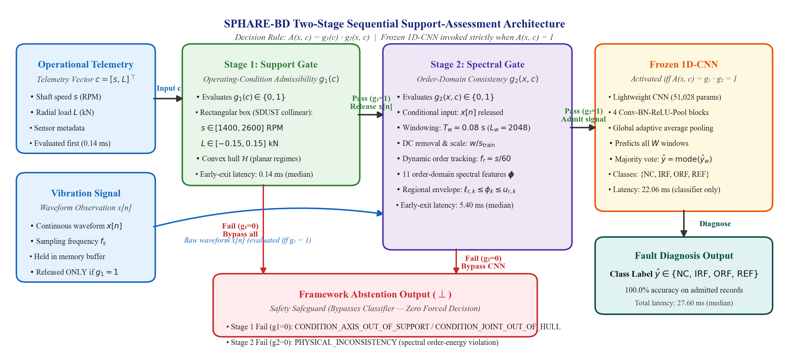

# SPHARE-BD: Hierarchical Support Assessment for Selective Bearing Fault Diagnosis Under Operating-Condition Shifts

[](https://www.python.org/)
[](https://pytorch.org/)
[](https://opensource.org/licenses/MIT)
[](https://signalprocessingsociety.org/publications-resources/ieee-signal-processing-letters)

Official research repository for:

> **"Hierarchical Support Assessment for Selective Bearing Fault Diagnosis Under Operating-Condition Shifts"**  
> *Md. Sulyman Islam Sifat and Md Alamgir Kabir (Senior Member, IEEE)*  
> **IEEE Signal Processing Letters (2026)**  
> Department of Computer Science and Engineering, Daffodil International University, Dhaka, Bangladesh.

---

## Architecture

SPHARE-BD introduces a hierarchical support-assessment architecture ($A(x, c) = g_1(c) \cdot g_2(x, c)$) with strict sequential early-exit short-circuiting for selective vibration-based fault diagnosis:

<p align="center">
  
</p>

<p align="center">
  <a href="docs/figures/SPHARE-BD_FRAMEWORK.pdf"><b>📄 Download High-Resolution Architecture Vector PDF</b></a>
</p>

### Pipeline Overview
1. **Stage 1 (Operating-Condition Support Gate $g_1(c)$):** Evaluates operational telemetry $c = [s, L]^T$ (speed $s$, radial load $L$) against the calibrated convex support boundary. Inputs failing Stage 1 immediately exit with early abstention ($\bot$).
2. **Conditional Signal Preprocessing & Windowing:** Upon passing Stage 1, vibration signal $x[n]$ is segmented into standardized non-overlapping windows and normalized using training scale statistics.
3. **Stage 2 (Order-Domain Envelope Gate $g_2(x, c)$):** Maps vibration signals to kinematic order spectra and checks physical spectral consistency against regional tolerance envelopes. Inconsistent signatures trigger early abstention ($\bot$).
4. **Frozen 1D-CNN Fault Classifier ($f_\theta(x)$):** Only inputs that pass both support stages are evaluated by the classifier, with window-level majority voting issuing the final health state diagnosis.

---

## Quick Start (One-Command Execution)

Clone the repository and run the end-to-end research pipeline:

```bash
git clone https://github.com/sulymansifat1/SPHARE-BD.git
cd SPHARE-BD
```

### Windows (One-Click)
Double-click `RUN_ALL.bat` or run in Command Prompt:
```cmd
RUN_ALL.bat
```

### Linux / macOS / Terminal
```bash
python run_all.py
```

### Options
```bash
# Run with existing active Python environment (bypass venv creation)
python run_all.py --no-venv

# Run for a specific random seed
python run_all.py --seeds 42

# Skip pre-flight unit tests
python run_all.py --skip-tests
```

When executed, `run_all.py` automatically checks dependencies, validates model checkpoints, runs in-domain and cross-machine evaluations, executes gate ablations, and generates figures and tables into a local `results/` folder.

---

## Installation & Requirements

- Python 3.9, 3.10, 3.11, or 3.12 (Tested on Python 3.11.9 64-bit)
- Standard x86_64 CPU (Inference runs in milliseconds on CPU)

Install required dependencies:
```bash
pip install -r requirements.txt
```

Core libraries: `torch`, `numpy`, `scipy`, `scikit-learn`, `pandas`, `matplotlib`.

---

## Modular Execution

Each experimental component can also be invoked independently:

```bash
# 1. Run Main Evaluation (SDUST & CWRU across seeds)
python experiments/run_experiment_a.py

# 2. Run Sequential Gate Ablation
python experiments/run_ablation.py

# 3. Recalibrate Post-Hoc OOD Baselines
python experiments/run_baselines.py

# 4. Run Controlled Synthetic Benchmarks
python experiments/run_synthetic.py

# 5. Benchmark Computational Latency
python experiments/run_latency_benchmark.py

# 6. Generate Publication Figures
python src/plot_figures.py
python src/generate_ieee_figures.py

# 7. Run Unit Tests
python -m unittest discover tests/
```

---

## Dataset Organization

Detailed instructions and checksums are provided in [data/README.md](data/README.md) and [docs/DATASETS.md](docs/DATASETS.md).

- **SDUST Dataset:** Deep groove ball bearing vibration recordings across speeds (1000–3000 RPM) and radial loads (0.0 & 20.0 kN). Manifest splits are pre-indexed in `data/manifests/sdust/`. Place raw `.mat` files in `data/sdust/` or export the path:
  ```bash
  # Windows CMD:
  set SPHARE_DATASET_ROOT=C:\path\to\datasets
  # PowerShell:
  $env:SPHARE_DATASET_ROOT="C:\path\to\datasets"
  # Linux / macOS:
  export SPHARE_DATASET_ROOT="/path/to/datasets"
  ```
- **CWRU Dataset:** 16 cross-machine evaluation recordings (12 kHz drive-end). Downloaded automatically by `run_all.py` from the official Case Western Reserve University Bearing Data Center if not locally present.

---

## Repository Structure

```text
SPHARE-BD/
├── run_all.py                   # Central pipeline runner
├── RUN_ALL.bat                  # Windows one-click launcher
├── requirements.txt             # Verified Python dependencies
├── pyproject.toml               # Package build configuration
├── LICENSE                      # MIT Open-Source License
├── CITATION.cff                 # Citation metadata
├── .gitignore                   # Git ignore specifications
│
├── checkpoints/                 # Verified frozen model checkpoints
│   ├── classifier_seed42.pt
│   ├── classifier_seed123.pt
│   └── classifier_seed2024.pt
│
├── configs/                     # Experiment configurations
│   ├── experiment_a.json
│   ├── synthetic_signal_config.json
│   └── freeze/                  # Frozen support envelopes & scale parameters
│
├── data/
│   ├── README.md                # Dataset placement and schema guide
│   ├── manifests/               # Deterministic split manifests (SDUST & CWRU)
│   └── baselines/               # Baseline sweep cache
│
├── docs/                        # Technical documentation
│   ├── figures/                 # Architecture diagram (PNG & vector PDF)
│   ├── ARCHITECTURE.md          # Theoretical derivation of support gates
│   ├── DATASETS.md              # Dataset specifications & acquisition
│   └── REPRODUCIBILITY.md       # Validation protocol and sanity checks
│
├── experiments/                 # Modular experiment scripts
│   ├── run_experiment_a.py      # Main SDUST + CWRU evaluation
│   ├── run_ablation.py          # Sequential gate ablation
│   ├── run_baselines.py         # Coverage-matched OOD baselines
│   ├── run_synthetic.py         # Synthetic benchmarks (Exp B & C)
│   └── run_latency_benchmark.py # Latency benchmarking
│
├── src/                         # Core library
│   ├── model.py                 # Frozen 1D-CNN backbone
│   ├── inference_engine.py      # Sequential short-circuiting inference engine
│   ├── plot_figures.py          # Figure rendering routines
│   ├── generate_ieee_figures.py # IEEE manuscript figures
│   ├── datasets/                # Dataset adapters and slice loaders
│   ├── preprocessing/           # Signal windowing & normalization
│   ├── support/                 # Stage 1 and Stage 2 support gates
│   ├── baselines/               # Post-hoc OOD baseline detectors
│   └── synthetic/               # Physics-informed synthetic signal generators
│
└── tests/                       # Unit test suite
```

---

## Citation

If you use SPHARE-BD in your research, please cite:

```bibtex
@article{sifat2026sphare,
  author    = {Sifat, Md. Sulyman Islam and Kabir, Md Alamgir},
  title     = {Hierarchical Support Assessment for Selective Bearing Fault Diagnosis Under Operating-Condition Shifts},
  journal   = {IEEE Signal Processing Letters},
  year      = {2026},
  publisher = {IEEE}
}
```

---

## License

- **Source Code:** [MIT License](LICENSE)
- **Checkpoints & Manifests:** [CC BY 4.0](https://creativecommons.org/licenses/by/4.0/)
- **Datasets:** SDUST and CWRU datasets are governed by their respective institutional terms.
